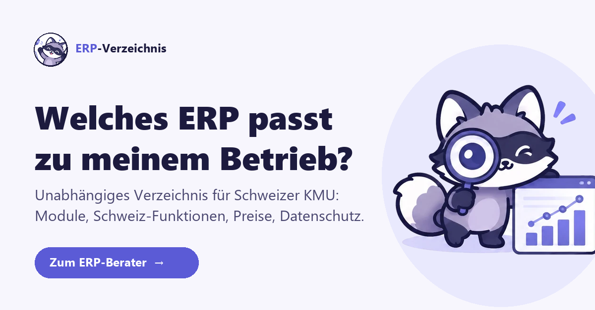

# ERP-Verzeichnis

**Welches ERP deckt ab, was mein Betrieb braucht – und was kostet es ungefähr?**



Ein unabhängiges, frei zugängliches Verzeichnis von ERP- und Buchhaltungslösungen für Schweizer KMU.
Im Zentrum steht der **Funktionsumfang** (Modul-Matrix mit 28 Bereichen), dazu Schweiz-Tauglichkeit
(Swissdec, MWST, QR-Rechnung, eBill, Bank), Betrieb, Preis, Einführungsaufwand und Datenschutz.
Begleitet wird man vom Waschbären **Lexu** (Bilder in `erpverzeichnis/static/maskottchen/`).

- Unabhängig: keine Werbung, keine Affiliate-Links, kein Tracking, keine Rangliste «bestes ERP»
- Quellen in jedem Steckbrief, unbelegte Angaben als «noch offen» markiert
- «Fehler melden» für Nutzer und Anbieter

**Fehler gefunden?** → [Issue eröffnen](../../issues/new?template=fehler-melden.yml)

**Lizenz:** Texte und Daten [CC BY 4.0](https://creativecommons.org/licenses/by/4.0/deed.de), Code MIT – siehe [LICENSE](LICENSE).

---

## Stand des Projekts

Vorgehen nach dem internen Briefing (`docs/`, nicht im Repository):

| Phase | Stand |
| --- | --- |
| 0 – Abgrenzung | Vorschläge aus dem Briefing übernommen (Schweiz, KMU 1–250 MA plus Gross-ERP, Buchhaltung als eigenes Segment, Ziel 60–100 Lösungen) |
| 1 – Longlist | `docs/longlist.csv` (lokal): Startliste des Briefings plus Funde aus der Swissdec-Liste |
| 2 – Schema | Datenmodell, Skala und Prüfregeln in `datencheck.py` fertig |
| 3 – Steckbriefe | Erste Runde: 36 Lösungen (10 Buchhaltung, 11 KMU-ERP, 5 Mittelstand, 2 Gross, 8 Branchen), rund 1000 Angaben noch «offen» |
| 4 – Qualitätssicherung | `datencheck.py --offen` liefert die Aufgabenliste |
| 5 – Marktanalyse | Gliederung mit automatischen Kennzahlen in `daten/Marktanalyse ERP Schweiz 2026.md` |
| 6 – Website | fertig: Berater, Verzeichnis, Steckbriefe, Vergleich, Grundlagen, Marktanalyse, Über, 404, Vorschaubild, GitHub Pages |

## Für Mitwirkende

Statische Website, gebaut aus `daten/` und veröffentlicht auf **GitHub Pages** – ohne Server, ohne Datenbank.
Abhängigkeiten nur `jinja2` und `markdown`.

### Lokal ansehen (Windows)

```powershell
python -m venv .venv                        # nur beim ersten Mal
.venv\Scripts\python -m pip install -r requirements.txt
.venv\Scripts\python build.py --serve
```

Dann http://127.0.0.1:8000 öffnen. Änderungen in `daten/` oder `erpverzeichnis/` werden automatisch neu gebaut.
Nur bauen: `.venv\Scripts\python build.py` → Ergebnis in `_site/`.

### Veröffentlichen

1. Code auf den Branch `main` pushen.
2. In GitHub: **Settings → Pages → Build and deployment → Source: «GitHub Actions»**.
3. Bei jedem Push baut `.github/workflows/pages.yml` die Seite (inkl. Datencheck). Enthalten die Daten Fehler,
   bricht der Build ab und die alte Version bleibt online.

Der Workflow setzt `ERP_SITE_URL` (öffentliche Adresse, nötig für die LinkedIn-Vorschau) und `ERP_REPO_URL`
(für «Fehler melden»). Bei eigener Domain `ERP_SITE_URL` im Workflow fest eintragen.

### Seiten

| Seite | Inhalt |
| --- | --- |
| `/` – **Berater** | Grösse → Branche → Bereiche (Mehrfachauswahl) → Betrieb. Bis zu drei Empfehlungen: «Beste Abdeckung», «Günstigste Lösung», «Guter Kompromiss» (oder «Beste Wahl», wenn beides zusammenfällt). Grösse × Branche sind eigene Seiten mit eigener Vorschau (`/berater/10-50/handel/`), Bereiche und Betrieb stehen als Parameter in der Adresse (`?modul=lohn,lager&betrieb=cloud`) und werden im Browser berechnet. |
| `/verzeichnis/` | Alle Lösungen mit Filtern in der Adresse (`?groesse=10-50&modul=lohn,lager&betrieb=cloud`) |
| `/erp/<id>/` | Steckbrief: Kurz gesagt, Darauf achten, Modul-Matrix, Schweiz-Tauglichkeit, Datenschutz, Quellen. Zusätzlich `steckbrief.html` für die seitliche Schublade. |
| `/vergleich/` | 2–4 Lösungen nebeneinander, Auswahl in der Adresse (`?ids=a,b,c`), «Nur Unterschiede» |
| `/grundlagen/` | Was ist ein ERP, Skala, Schweiz-Pflichten, Kosten, Datenschutz, Vorgehen, Glossar |
| `/marktanalyse/` | `daten/Marktanalyse*.md` |
| `/ueber/` | Projekt, Methodik, Vollständigkeit, Fehler melden, Lizenz |

**Adressen nicht mehr umbenennen** – Berater-Pfade (`GROESSEN`/`BRANCHEN`), Parameter (`BEDARF`) und IDs stehen in geteilten Links.

### Daten aktualisieren

Alle Inhalte kommen aus `daten/erp_verzeichnis.json` und `daten/Marktanalyse*.md`.

- Mit Claude Code: Skill **`/erp-daten-aktualisieren`** (`.claude/skills/erp-daten-aktualisieren/SKILL.md`)
- Danach: `.venv\Scripts\python datencheck.py --fix` (und `--offen` für die Liste offener Prüfpunkte)

Die Empfehlungslogik steht in `erpverzeichnis/data.py` **und** `erpverzeichnis/static/app.js` (Kommentar «PUNKTELOGIK») – Änderungen an beiden Stellen machen.

### Design und Maskottchen

Farben, Formen und Schrift sind vom Maskottchen abgeleitet: Tinten-Navy der Konturen, Indigo der Diagramme,
Lavendel des Fells, runde «Sticker»-Karten mit Bodenschatten. Der Datenschutz-Teil ist ein dunkler «Tresor»
im Stil der Security-Bilder. Hell- und Dunkelmodus folgen der Systemeinstellung.

- Maskottchen neu schneiden: `.venv\Scripts\python design\maskottchen_schneiden.py` (Pillow: `pip install -r design\requirements.txt`)
- Vorschaubild neu erzeugen: `.venv\Scripts\python design\build_og_bild.py`
- Name des Maskottchens: `MASKOTTCHEN_NAME` in `erpverzeichnis/site.py`

### Struktur

```
daten/                      Daten (JSON) und Marktanalyse – daraus wird die Website gebaut
docs/                       Nur lokal (in .gitignore): Briefing, Longlist, Maskottchen-Bögen
build.py                    Baut die Website nach _site/ (--serve: lokale Vorschau)
datencheck.py               Validierung (--fix Zähler, --offen Aufgabenliste)
erpverzeichnis/data.py      JSON laden, Werte in Alltagssprache, Filter, Empfehlungslogik
erpverzeichnis/site.py      Seiten erzeugen
erpverzeichnis/ui.py        Icons, Maskottchen-Bausteine
erpverzeichnis/templates/   HTML (Jinja2)
erpverzeichnis/static/      CSS, JS, Maskottchen (WebP), Vorschaubild
design/                     Skripte für Maskottchen und Vorschaubild
.github/                    GitHub Pages, Formular «Fehler melden»
```
